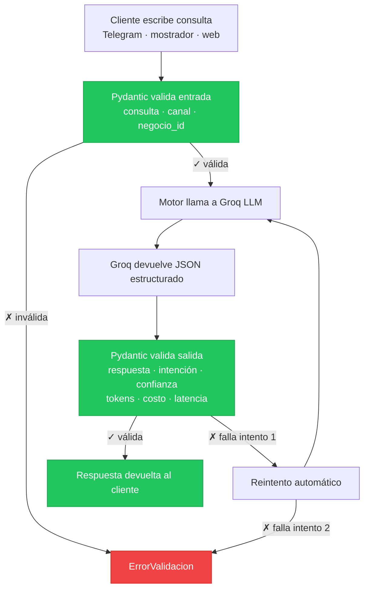

# fde-unacosita

Proyecto del curso **Forward Deployed Engineer** — Ferretería UnaCosita.

Motor LLM base con validación Pydantic y medición de tokens/costo/latencia usando Groq.

## Caso de uso

Asistente de ventas multicanal (Telegram, mostrador, web) que responde consultas de precio, stock y presupuesto de productos de ferretería. Cada consulta es validada estructuralmente, procesada por un LLM y devuelta con métricas de uso reales.

## Diagrama de flujo



PE3 incorporará una etapa de búsqueda semántica (RAG) sobre el catálogo de productos en Neon antes de llamar al LLM.

## Requisitos

- Python 3.11+
- Cuenta en [Groq](https://console.groq.com) con API key
- Variables de entorno configuradas (ver `.env.example`)

## Setup

```bash
python -m venv .venv
.venv\Scripts\activate      # Windows
pip install -r requirements.txt
cp .env.example .env        # completar GROQ_API_KEY
```

## Correr pruebas PE2

```bash
cd src
python ../scripts/ejecutar_5_consultas.py
```

## Estructura

```
src/
  modelos.py          # Pydantic: Entrada, Salida, ErrorValidacion
  motor.py            # Motor LLM (Groq)
  db.py               # Conexión SQLAlchemy (se expande en PE3)
  prompts/
    consulta_precio.txt
scripts/
  ejecutar_5_consultas.py
```
